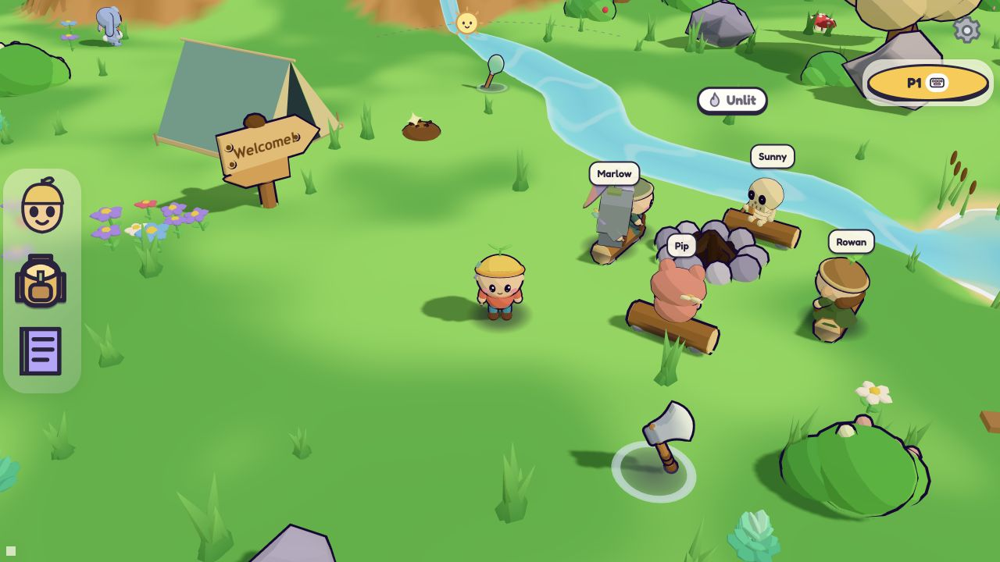

# Game presentation update

This change runs on the existing Three.js ES modules with no React, database,
account service, bundler or new package dependencies. Start the game with the
existing `npm start` command, or serve `public/` as a static site.

## Player experience

The original Sprout character remains available. Five optional cosmetic islanders
sit around the actual starting campfire: Rowan, Pip, Marlow, Clover and Sunny the
friendly skeleton. Click or tap an islander to choose; keyboard-accessible labels
provide the same action. Unchosen friends stay seated, with occasional short
greetings. Returning to the camp allows a short, smooth handoff between characters.
Their abilities, collision, tools and quests stay the same.

The face button in the left dock opens browser-local character controls. Players
can give their character a name and choose an optional lantern, torch, flower,
pinwheel or umbrella. Gameplay tools take precedence over cosmetic carryables.
These controls run as ordinary DOM elements and require no account. Preferences
use `infiniteIsland.character.v1`; existing world-progress saves are preserved.
The bag and journal share the same dock and only one personal panel opens at once.

A skippable opening camera frames the current island before approaching the player.
The original fixed camera remains the default. The optional follow camera eases
behind the player, uses a stable movement basis and adjusts around terrain/static
colliders. Shared-screen multiplayer and special scenes retain their original
framing. For a local inspection from the browser console:

```js
__game.followCam.setSettings({ mode: 'follow', angle: 28, distance: 12, smoothness: 0.6 });
__game.followCam.setSettings({ mode: 'original' });
```

The optional follow camera is exposed through this API; this PR does not add a
world-editor settings panel. In `?debug` mode, arrows move the inspection camera,
WASD still controls the player, and drag/scroll rotate and zoom.

## Visual and sound changes

- Softer terrain color transitions and compact, gentler shadows.
- Varied grass shape and wind phases without changing seeded placement.
- Five smaller, widely spread butterflies with independent heights and long glides;
  sparse firefly gatherings around vegetation and water.
- Coastal life, campsite dressing and camp sleep presentation, with visibility and
  draw/geometry limits covered by focused tests.
- Rounded rock and autumn foliage treatments; smoother stream/shore presentation.
- A quiet dotted day indicator with sun/moon crossfade; mobile uses a compact wheel.
- A consolidated settings/help menu, collapsible player roster and personal dock.
- Slower exploration music with tempo changes preserving pitch and musical position.

Network poses carry an optional cosmetic variant field. Original/older packets
remain valid and unknown variants fall back to Sprout. World authority and hashes
are unchanged. Carryables are browser-local decoration, not inventory or abilities.

## Verification



Browser verification on this independent branch confirmed Sprout selection, the
local appearance panel, equipping the rainbow pinwheel, closing the panel and the
settings menu, with no console errors.

The independent branch was checked with Node 24 on 2026-10-24:

| Run | Tests | Passed | Failed | Wall time |
| --- | ---: | ---: | ---: | ---: |
| Focused presentation + packet compatibility | 128 | 128 | 0 | 1.84 s |
| Full upstream + presentation suite | 1,411 | 1,406 | 5 | 28.53 s |

The five failures are the existing seeded-placement/terrain portability cases in
`boatCourses.test.js`, `cinder.test.js`, `glimmerfrost.test.js`, `hop.test.js` and
`terrain.test.js`. They are reproduced upstream baseline failures, not new
presentation regressions. Their portability fixes belong to the separate
test-tooling PR; this game PR retains those assertions unchanged.

The small `camera/introFog.js` helper preserves aerial-opening visibility without
the removed editor bridge and restores the exact ground-view fog afterward.

Node checks cover geometry bounds/disposal, camera math, saved-world invariants,
protocol compatibility and timing. Real device/performance checks remain separate from the browser verification
above; a screenshot from the combined fork is not proof of this independent change. Version remains the upstream 0.82.3 until coordinated
release integration.
