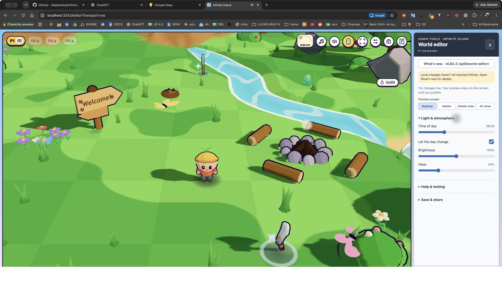
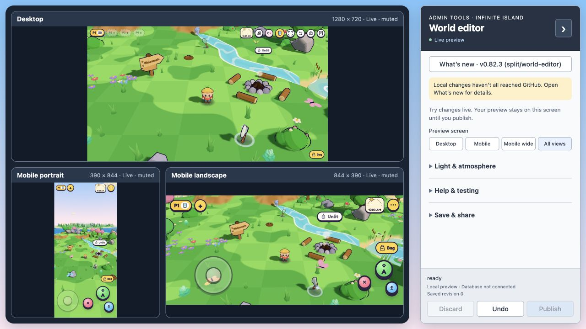

# Optional world editor setup

Use Node 22 or 24 (24 recommended), `npm install`, then `npm start`. The prestart hook bundles the optional React editor/cloud components; the original game stays in plain ES modules. Open `http://localhost:3000/editor` or `/?admin`. Server port can be changed with PORT.

The original game supports time of day, day cycling, brightness and haze. Other controls appear only when a game adapter implements them; this change does not add character variants, held props, follow cameras, scenery, music-tempo or wildlife changes. No build or dependency on the separate game-presentation or test-tooling changes is assumed.

For local publishing, copy `.env.example` to `.env.local`, fill the two browser-public Supabase values, and restart. See [Supabase setup](SUPABASE.md) for schema, RLS and trusted admin bootstrap. No secret/service-role keys may be placed in browser configuration.

`npm run build` creates static `dist/`; Vercel uses that output and supports `/editor`. `server.js` is a local static/WebSocket relay, not a persistent Vercel function. PeerJS remains the existing static-host transport. Configure Preview and Production environments separately.

All views runs three independent muted, ephemeral, disconnected game renderers. These compare browser layouts, not real-device GPU performance. Returning to a single view closes them. Shared progress is never copied into child previews.

The optional `src/profiles` component and owner-controlled database tables provide appearance/account persistence through an explicit getCharacter/setCharacter adapter; no profile launcher is added to the original game in this PR. It strips shared progress and unsupported presentation metadata.

Set `ISLAND_RELEASE_REPOSITORY=owner/repository` for a fork before building or publishing formal releases; its default is the upstream repository. [Release procedure](RELEASING.md) describes clean-build verification. No cloud resources, releases or deployments are created automatically.

Targeted checks: `node --test test/worldSettings.test.js test/editorBridge.test.js test/previewRuntime.test.js test/adminTools.test.js test/profiles.test.js test/releaseStatus.test.js test/releasePublication.test.js`. Run the full original suite separately; existing Node 24 fingerprint portability failures are owned by the independent test-health PR.

## Validation of this standalone change

| Check | Result | Scope |
|---|---|---|
| Focused Node 24 tests | 46 passed | Settings validation, revisions, private drafts, preview isolation, admin actions, profiles and release metadata |
| Embedded Postgres checks | Passed, including 87 validation cases | Actual migrations, RLS, owner isolation, optimistic revisions and settings validation; local auth stand-ins |
| Local and production bundles | Passed | Admin, cloud and optional profile bundles; static output |
| Standalone browser smoke check | Passed | Original game, supported editor controls and all three comparison frames reporting Live · muted |
| Hosted Auth / Realtime / publishing | Not exercised by this split | Requires project configuration and authenticated admin setup |
| Full upstream Node 24 suite | Not claimed green | Five existing fingerprint portability failures are handled by the separate test-health PR |

Browser evidence: [editor single view](screenshots/editor-split.jpg) and [All views](screenshots/editor-all-views-split.jpg). These are the independent editor branch running against the original game, with no Supabase project connected.

