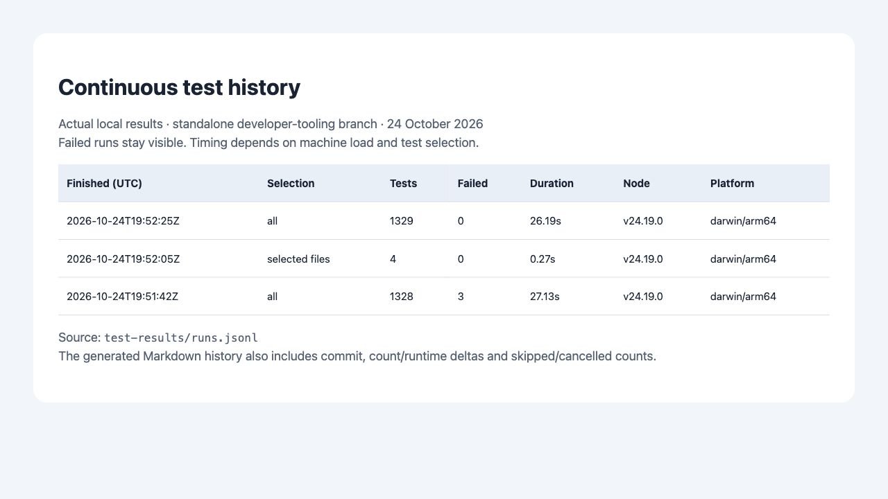

# Test health and timing

## Continuous local checks

Run `npm run dev:check` once and leave the terminal open. It immediately runs the full test suite, then builds the local app, when `scripts/build.mjs` exists, only if tests pass. It watches source, tests and build scripts and repeats after edits, with a short debounce and only one run at a time. Changes during tests queue a fresh run before building. Generated output is ignored to avoid loops. Refresh localhost after a successful build; this does not start the server or provide hot reload. Ctrl+C stops the watcher. It never commits or deploys.

For faster focused work, choose explicit batches:

```sh
npm run test:batch -- --list
npm run test:batch -- world gameplay
npm run test:batch -- world --dry-run
npm run dev:check -- world gameplay
```

Empty categories are reserved for optional features and cannot be run until they contain tests. Batches: `editor`, `release`, `camera`, `ui`, `multiplayer`, `party`, `boat`, `characters`, `audio`, `world`, `gameplay`, and `infrastructure`. Selection is explicit, not automatic dependency analysis. Focused watch mode reruns those selected batches on each source change; run the full suite before releasing cross-cutting changes. `npm test` and GitHub Actions still run everything. The manifest in `scripts/test-batches.json` assigns each test file exactly once; new files must be categorized or the batch runner fails visibly.

Run the normal suite with `npm test`. Use Node 24 for CI and the timing reporter:

```sh
node scripts/test-timings.mjs
node scripts/test-timings.mjs --json /tmp/infinite-island-timings.json
node scripts/test-timings.mjs test/duskAtmosphere.test.js
```

The timing runner executes all `test/*.test.js` files unless filenames are supplied.
It retains Node's file isolation and normal exit status, prints failures, lists the
15 slowest tests, and optionally writes a machine-readable timing report. It does
not skip balance simulations or other long tests. Parallel-test timings include
CPU contention; rerun selected files individually to measure an optimization.

GitHub Actions runs the complete suite on Linux and macOS with Node 24 for pushes
to `main` and pull requests. Each job uploads its timing report, including on a
failed test run. Hosting deployment is a separate integration.

## Automatic run history

All repository test commands now append completed results to `test-results/runs.jsonl` and render `test-results/history.md`. Run `npm run test:history` to regenerate the newest-first table. It includes batch, commit, counts, failures, skipped/cancelled tests, duration and colored deltas against the previous successful comparable run. Local history is Git-ignored; CI uploads its own history artifact. Direct `node --test` and interrupted runs without a final summary are outside this recorder. Test duration excludes builds and is not an application-performance benchmark.

## Baseline portability investigation

The unchanged baseline had five failures on macOS ARM with Node 24.19.0 and
24.22.1. Running the same world-generation code on Node 18.13.0, both ARM and x64,
reproduced the original fixture values and placement fingerprints. Comparing the
actual records showed:

- Home terrain at `(42.5, 25)`: height changed by `2.6645352591003757e-15`.
- Emberleaf flower index 52: only `y` changed by `2.220446049250313e-16`.
- Frostpine tuft index 336: only `y` changed by `6.661338147750939e-16`.
- Counts, horizontal positions, identities, interaction flags, and every other
  field were unchanged.

These are runtime floating-point differences, rather than moved world objects.
The original Node 18 placement records are preserved in `test/fixtures/emberFlowers.json`
and `frostTufts.json`. The shared assertion first verifies each fixture's original
historical fingerprint, then compares all fields exactly except `y`, where it
allows `1e-12` world units. Other placement families keep their exact hash tests.
The terrain golden test permits the same tiny height tolerance and still requires
exact ground-type and walkability matches. No generation code or saved identities
were changed to resolve the failures.

## Expensive tests and coverage

The original complete run took 42.4 seconds on the local Mac. Its two lid coverage
tests reported 19.6 and 6.8 seconds under parallel load. Those tests raycast every
sample against the entire lid mesh, repeatedly examining unrelated triangles.
The test-only spatial helper partitions every original triangle into bounded
chunks and delegates intersections to Three's normal raycaster. Every sample ray
and triangle remains included. Independent helper tests check indexed and
nonindexed meshes, transformed world coordinates, hits, misses, and triangle count;
the exhaustive coverage test also checks sample hits against the original mesh.
A back-to-back comparison on the same runtime and current production modules
ran all seven atmosphere tests in 13.5 seconds using the original test file and
7.6 seconds using the partitioned version while other work continued. Earlier
isolated optimized runs took 2.8-3.1 seconds. These timings vary with CPU contention;
no sample rays or triangles were removed.

A complete timing run after this change passed 1,334 tests in 32.3 seconds, including
new visual-polish tests being added concurrently. This is directional evidence,
not a controlled benchmark: test counts and parallel contention changed.

The final fork-integration run on Node 24.19.0 passed **1,374/1,374 tests**
with no skips in **114.6 seconds** while browser and other verification work were
active. Treat this separately from the earlier optimization measurements: parallel
test wall times include machine contention, and these runs are not a controlled
before/after application-performance benchmark.

Six redundant version-only tests and two unrelated version assertions inside
feature tests were consolidated into one release-metadata test. It checks the
game's numeric release version against `package.json` and both lockfile version
records, avoiding eight files that otherwise needed edits on every release.
Gameplay, geometry fingerprints, and seeded balance coverage were retained.

The next largest costs are seeded party-balance simulations (Bonk Burrows was
about 14.7 seconds in that run), real-player integration simulations, and geometry
rebuild checks. These exercise fairness, lifecycle, and actual scene behavior;
removing seeds or replacing them with mocks solely to reduce runtime would weaken
coverage. Keep them in CI and profile individually before optimizing.

Some arc-specific placement fingerprints repeat across tests. They document that
each later feature preserves earlier layouts, so retain those assertions. Shared
fixture assertions now centralize the numerical portability handling.

Node tests do not verify rendered GPU output, sound by ear, real phone controls,
physical controllers, or browser/network lifecycle behavior. Those still require
browser smoke checks and real-device playtests.

## Standalone tooling split verification

On 2026-10-24, this tooling-only branch passed 1,329 tests in 26.19 seconds on Node 24/macOS arm64, plus a final four-test batch/history check. This is a branch-specific snapshot, not comparable to the combined fork's larger suite.



Screenshot: an HTML rendering of the recorded JSONL results for this split, including the initial failed extraction check. The persistent report itself is `test-results/history.md`.
